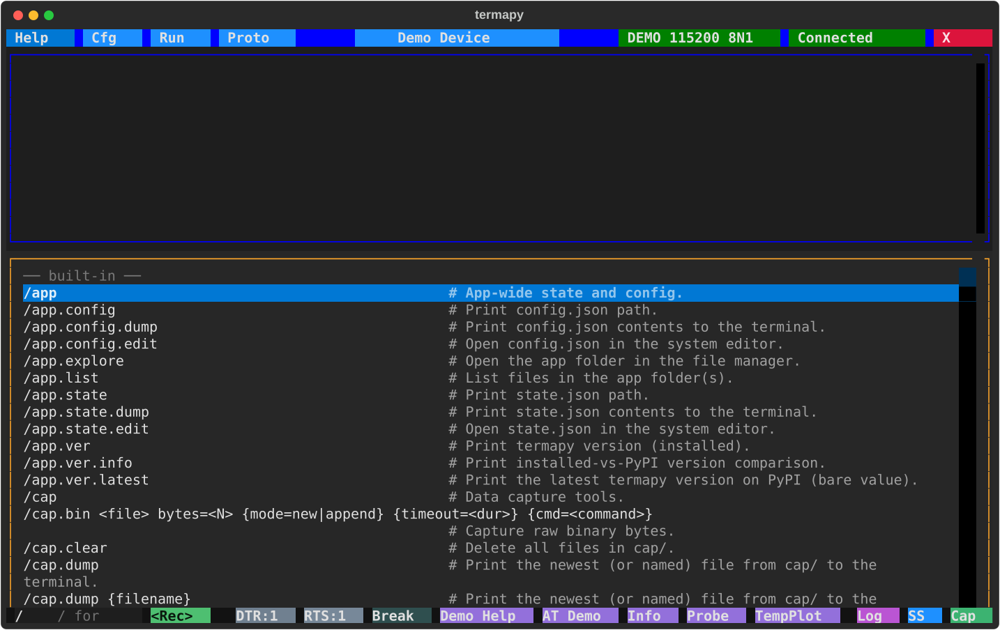

# REPL commands

Commands prefixed with `/` (configurable via `cmd_prefix`) run locally instead of being sent to the serial device.

Click the **/** button (or just type `/`) to browse every command with its
synopsis, filtering as you type:

> **NOTE:** If the device you are communicating with uses `/` commands that conflict with termapy's, you can change the prefix by setting `cmd_prefix` in your config (e.g. `cmd_prefix: "!"`). With `!` as the prefix, `!help` runs the local help command and `/foo` gets sent verbatim to the device.

A selection of the most-used commands.  `/help` prints the full landscape
(every command, including the `/app.*`, `/mcp.*`, `/port.chip.*` and
`/proto.crc.<language>` families not listed here) and `/help <cmd>` the
man-page detail for one.

## Boolean values

Every boolean termapy reads from text, whether typed at the prompt, in a
`.run` script, as a `key=value` keyword, in a `$(env.X)`-templated config
key or in an environment variable, uses one vocabulary, case-insensitive:

| True                                | False                                |
| ----------------------------------- | ------------------------------------ |
| `on`, `true`, `yes`, `1`, `y`, `t`  | `off`, `false`, `no`, `0`, `n`, `f`  |

A setting command (`/term.echo`, `/term.hex`, `/cli.completion`, ...) also
takes the verb `toggle`, and a bare invocation shows the current value
without changing it.  Leaving an optional boolean out means its documented
default.  Any other word is an error that names the accepted tokens, never
a silent off: `Invalid echo: maybe (use on/off/true/false/yes/no/1/0/y/n/t/f)`.

A command that opens a file of a known type takes the name with or without
its extension: `/run hex_view` runs `run/hex_view.run`. The same holds for
`/proto.run`, `/profile.load`, `/sym.load` and a folder's `.dump` and
`.rename`. The extension is added only when that file exists, so `v1.2`
finds `v1.2.run`. `.rename` changes the name and never the extension:
`/run.rename v1.2 v1.3` gives `v1.3.run`. `/edit` needs the extension,
because its folders hold different types of file.

| Command                   | Description                                                                 |
| ------------------------- | --------------------------------------------------------------------------- |
| `/cap`                    | Open the cap/ folder (same as the Cap button and `/cap.explore`)            |
| `/cap.bin <f> ...`        | Capture raw binary bytes to a file                                          |
| `/cap.hex <f> ...`        | Capture hex text lines, decode with format spec to CSV                      |
| `/cap.poll {count=N} {delay=<dur>} {file=<f>} cmd=<cmds>` | Poll commands on a schedule; print rows, optionally save CSV/JSONL |
| `/cap.stop`               | Stop an active capture                                                      |
| `/cap.struct <f> ...`     | Capture binary data, decode with format spec to CSV                         |
| `/cap.text <f> ...`       | Capture serial text to file for a timed duration                            |
| `/cap.wire {wait_gap=<dur>} cmd=<command>` | Run a command and show TX/RX bytes inline as hex + repr (debug line endings) |
| `/cfg {key {value}}`      | TUI bare: open the Cfg picker. CLI bare: list configs. With args: get/set.  |
| `/cfg.auto <key> <val>`   | Set a config key without confirmation                                       |
| `/cfg.delete <name>`      | Delete a config and its whole folder after asking (MCP: `confirm=true`); never the active one |
| `/cfg.dump`               | Print the config in memory as JSON                                          |
| `/cfg.edit`               | Edit the current config file (same as `/edit.cfg`)                          |
| `/cfg.file <name>`        | Print a file from the config folder (subfolders allowed)                    |
| `/cfg.list`               | List all config files                                                       |
| `/cfg.help`               | Show `/cfg` help (alias for `/help cfg`)                                    |
| `/cfg.info {--display}`   | Write and show the project report (tree, config, buttons, log and history tails); also written at exit; `--display` opens it |
| `/cfg.load <name>`        | Switch to a different config by name                                        |
| `/cfg.new <name> <port> {baud} {mode}` | Create a config for a port (settings as `/port.connect`); asks before replacing one; TUI bare: the New Config wizard. `/cfg.load <name>` switches to it |
| `/cfg.rename <name> <new>` | Rename a config, folder and file together; never the active one           |
| `/cfg.show`               | Open the current config file in the system viewer                           |
| `/cls`                    | Clear the terminal                                                          |
| `/confirm {message}`      | Ask Yes/Cancel (TUI dialog, CLI y/n); Cancel stops a script                 |
| `/credits`                | Print acknowledgments (libraries and authors termapy depends on)            |
| `/delay <duration>`       | Wait for a duration (e.g. `500ms`, `1.5s`); Escape/Ctrl+C cancel            |
| `/edit <file>`            | Edit a project file (`run/`, `proto/` or `plugin/`)                         |
| `/edit.cfg`               | Edit the current config file                                                |
| `/edit.info`              | Open the info report in the system viewer                                   |
| `/edit.plugin {file}`     | Edit a plugin, or list available plugins if no name given (also `/plugin.edit`) |
| `/edit.proto {file}`      | Edit a .pro file. Bare: TUI opens the Proto picker, CLI lists (also `/proto.edit`) |
| `/edit.run {file}`        | Edit a .run script. Bare: TUI opens the Run picker, CLI lists (also `/run.edit`) |
| `/env.list {pattern}`     | List environment variables (all, by name, or glob)                          |
| `/env.reload`             | Re-snapshot variables from the OS environment                               |
| `/env.set <name> <value>` | Set a session-scoped environment variable                                   |
| `/exit`                   | Exit termapy                                                                |
| `/expect {timeout=<dur>} match=<text>` | Wait for a serial line containing text (default 5s; a timeout stops a script) |
| `/expect.regex {timeout=<dur>} match=<pat>` | Wait for serial-output line matching regex                         |
| `/find {pattern}`         | Navigate scrollback matches with an interactive find bar (not over MCP; use `/grep` there) |
| `/find.next` / `/find.prev` | Step to next / previous find match                                        |
| `/find.clear`             | Close the find bar (or run `/find` with no args)                            |
| `/grep <pattern>`         | Search scrollback for regex matches (case-insensitive, prints the list)     |
| `/help`                   | Clean landscape of every command (name + one-liner)                         |
| `/help <term>`            | Exact match -> man-page detail; otherwise a candidate list                  |
| `/help.dev <cmd>`         | Show a command handler's Python docstring (developer view)                  |
| `/help.plugin`            | List loaded plugins grouped by source                                       |
| `/help.run`               | List available .run scripts with descriptions                               |
| `/help.target`            | Show only imported target device commands                                   |
| `/log`                    | Open the session log (same as the Log button and `/log.show`)               |
| `/log.delete`             | Delete the session log file (TUI only; the CLI keeps no log)                |
| `/log.dump {N}`           | Print the session log (all, or an N-line slice) to the terminal             |
| `/log.fingerprint`        | Write a full session fingerprint (OS, terminal, port params) to the log     |
| `/log.show`               | Open the session log in the system viewer                                   |
| `/mcp.catalog`            | Print the JSON command catalog (same content as termapy://commands.json MCP resource) |
| `/mcp.info`               | Show MCP-mode status (pid, catalog size, port, profile, captures)           |
| `/mem.and <target> <mask>` | AND a mask into one word (atomic via MEM.M when available)                 |
| `/mem.dump <target> {len} {type}` | Hexdump or typed word columns; `addr=`/`ascii=` toggle columns      |
| `/mem.clear <target> <mask>` | Clear mask bits in one word: `word &= ~mask` (atomic via MEM.M)          |
| `/mem.info`               | Memory access config: dialect, block limit, width, endian, atomic modify    |
| `/mem.not <target>`       | Invert one word (always read + write-back)                                  |
| `/mem.or <target> <mask>` | OR a mask into one word (atomic via MEM.M when available)                   |
| `/mem.read <target> {type}` | One typed value: scalar, char, register field, bit or slice               |
| `/mem.str <target> {max}` | Read a NUL-terminated string                                                |
| `/mem.write <target> <hex>` | Write hex bytes, or set a register field/bit (audited)                    |
| `/mem.xor <target> <mask>` | XOR a mask into one word (always read + write-back)                        |
| `/os <cmd>`               | Run a shell command (requires `TERMAPY_OS_CMD_ENABLED=1` in env)            |
| `/port {name}`            | TUI bare: open Port picker. CLI bare: list ports. With name: open it.       |
| `/port.baud_rate {value}` | Show or set baud rate (hardware only)                                       |
| `/port.break {ms}`        | Send break signal (default 250ms)                                           |
| `/port.byte_size {value}` | Show or set data bits (hardware only)                                       |
| `/port.cd`                | Show CD state (read-only)                                                   |
| `/port.connect {name} {baud} {mode}` | Connect with optional baud and mode (e.g. /port.connect COM3 9600 N81) |
| `/port.cts`               | Show CTS state (read-only)                                                  |
| `/port.disconnect`        | Disconnect from the serial port                                             |
| `/port.dsr`               | Show DSR state (read-only)                                                  |
| `/port.dtr {on\|off}`     | Show or set DTR line                                                        |
| `/port.flow_control {m}`  | Show or set flow control: none, rtscts, xonxoff, manual                     |
| `/port.help`              | Show `/port` help (alias for `/help port`)                                  |
| `/port.info`              | Show port status, serial parameters, hardware lines, and xfer root          |
| `/port.list`              | Chip-aware port table (MFG, CHIP, SPEED, VID:PID, SN, ...)                  |
| `/port.mode {baud} {mode}` | Show or set serial mode (e.g. /port.mode 9600 N81)                        |
| `/port.parity {value}`    | Show or set parity (hardware only)                                          |
| `/port.ri`                | Show RI state (read-only)                                                   |
| `/port.rts {on\|off}`     | Show or set RTS line                                                        |
| `/port.stop_bits {value}` | Show or set stop bits (hardware only)                                       |
| `/print <text>`           | Print a message to the terminal                                             |
| `/print.r <text>`         | Print Rich markup text (e.g. `[bold red]Warning![/]`)                       |
| `/profile.info`           | Show metadata of the active profile (plus cfg-vs-profile transport drift)   |
| `/profile.load <path>`    | Load a device profile and set the active_profile namespace                  |
| `/profile.load cmd=<command>` | Fetch a profile from the connected device (replaces the retired `/include`) |
| `/profile.load`           | Reload the current source (file or device cmd, whichever was last used)     |
| `/profile.save {<path>}`  | Write the active profile to disk (default: `<cfg_dir>/<cfg_name>.profile.json`) |
| `/profile.unload`         | Clear the active profile                                                    |
| `/profile.validate <path>`| Validate an MCP device profile against the schema                           |
| `/proto`                  | TUI bare: open the Proto picker. CLI bare: list proto/.                     |
| `/proto.crc.calc <n> {d}` | Compute CRC over hex bytes, quoted text, or a file                          |
| `/proto.crc.detect {<frames>...}` | Name the catalog CRC on a batch of frames' trailing bytes            |
| `/proto.crc.find bin=<hex>\|asc=<text>\|cmd=<trigger>` | Identify the CRC algorithm from a captured packet, or from a trigger's response |
| `/proto.crc.info <name>`  | Show CRC algorithm parameters and description                               |
| `/proto.crc.list {pat}`   | List CRC algorithms (optional glob filter)                                  |
| `/proto.crc.reverse {cmd=<trigger> count=<N>} {packet-hex}...` | Recover the Rocksoft parameters of an unknown CRC |
| `/proto.crc.verify <name> {endian=be\|le} <hex>...` | Verify a packet's trailing CRC against a named algorithm |
| `/proto.debug <file>`     | Open interactive protocol debug screen for a .pro script (bare: Proto picker) |
| `/proto.edit {file}`      | Edit a .pro file (same as `/edit.proto`)                                    |
| `/proto.help`             | Show `/proto` help (alias for `/help proto`)                                |
| `/proto.hex {on\|off\|toggle}`    | Same flag as `/term.hex`                                                    |
| `/proto.list`             | List .pro files in proto/, newest first, with size, age and each one's `name` |
| `/proto.run <file>`       | Run a binary protocol test script (.pro); TUI bare: the Proto picker        |
| `/proto.send <hex>`       | Send raw hex bytes and display response                                     |
| `/proto.info`             | Print current protocol mode state                                           |
| `/raw <text>`             | Send text exactly as typed: no line ending, expansion or transforms         |
| `/repeat ...`             | Repeat a command N times: `count=<N> {delay=<dur>} {var=<name>} cmd=<cmd>`  |
| `/run {file}`             | TUI bare: open Run picker. CLI bare: list scripts. With file: run it.       |
| `/run.edit {file}`        | Edit a .run script (same as `/edit.run`)                                    |
| `/run.help`               | Show `/run` help (alias for `/help run`)                                    |
| `/run.legacy <file\|*>`   | Find renamed (legacy) command names in scripts; `--fix` rewrites in place   |
| `/run.list`               | List .run files in run/, newest first, with size, age, and summary          |
| `/search <term>`          | Deep search: name, help, args, flags, long help (multi-term, `-exclude`, regex) |
| `/seq`                    | Show sequence counters                                                      |
| `/seq.reset`              | Reset all sequence counters to zero                                         |
| `/show <name>`            | Show a file                                                                 |
| `/show.cfg`               | Show the current config file                                                |
| `/ss`                     | Open the screenshot folder (same as the SS button and `/ss.explore`)        |
| `/ss.svg {name}`          | Save an SVG screenshot                                                      |
| `/ss.txt {name} {N}`      | Save a text screenshot (all, or an N-line slice)                            |
| `/stop`                   | Abort a running script                                                      |
| `/sym <addr\|name>`       | Symbol table: name to address, or address to `name+offset`                  |
| `/sym.import {file} {format=<value>}` | Convert a linker map to `sym/<cfg>.symbols.json` and load it (bare: re-import the same map) |
| `/sym.info`               | Show the loaded symbol table: file, source, counts by section, range        |
| `/sym.load {path}`        | Load a symbol table (default: the cfg sidecar `/sym.import` writes)         |
| `/sym.search <pattern>`   | Search symbols by name: exact, glob, regex, or substring                     |
| `/sym.unload`             | Clear the loaded symbol table                                               |
| `/dev.import <file> {format=<value>}` | Convert a vendor register description (CMSIS-SVD) into this config's `lib/` and reference it from `dev/` (`to=global` shares it) |
| `/dev.lib {pattern}`      | List the parts the libraries hold (available, not loaded), with their layer |
| `/dev.list`               | List the devices this config has loaded, with layer and placement           |
| `/dev.use <part> {at=<value>}` | Add a library part to this config; `at=NAME@ADDR ...` places a relocatable one |
| `/term`                   | Terminal display / session toggles (echo, line_no, timestamps, ...)         |
| `/term.color {on\|off\|toggle}`   | Toggle rendering of device ANSI color (TUI and CLI)                        |
| `/term.echo {on\|off\|toggle}`    | Toggle local echo of device commands (see also `/term.echo_repl`)           |
| `/term.encoding {name}`   | Show or set byte-decoding encoding (utf-8, latin-1, ...)                    |
| `/term.eol {cr\|lf\|crlf\|none\|cycle}` | Show or set the line ending sent with commands (session override)    |
| `/term.eol.rx {auto\|cr\|lf\|crlf\|cycle}` | Show or set how received output is split into lines (receive newline) |
| `/term.hex {on\|off\|toggle}`     | Toggle hex display of incoming bytes                                        |
| `/term.info`              | Snapshot the state of every `/term.*` toggle                                |
| `/term.json {compact\|indent\|color\|cycle}` | How JSON answers print: one line, indented, or indented and colored |
| `/term.eol.markers {on\|off\|toggle}` | Toggle visible `\r` `\n` markers in serial output                       |
| `/term.line_no {on\|off\|toggle}` | Toggle line numbers in serial output (TUI only)                             |
| `/term.log <text>`        | Append a line to the session log without echoing to screen                  |
| `/term.output {level\|cycle}` | Show, set, or cycle output level (silent/quiet/normal/verbose)                      |
| `/term.request {on\|off\|toggle}` | Session JSON dial: every answer (device or termapy command) becomes a JSON envelope; `<cmd> --json` is the per-call form |
| `/term.send <text>`       | Send literal text to the serial port (with line ending; canonical name for the bare-line send) |
| `/term.send_bare_enter {on\|off\|toggle}` | Send line ending on empty Enter                                     |
| `/term.timestamps {on\|off\|toggle}` | Toggle `[HH:MM:SS.mmm]` timestamp prefix                                 |
| `/term.usb_db`            | Report bundled USB vendor-database freshness (local read)                   |
| `/var {name}`             | List user variables, or show one by name                                    |
| `/var.clear`              | Clear all user variables                                                    |
| `/var.list`               | List user variables (explicit alias for bare `/var`)                        |
| `/var.set <NAME> <value>` | Set a user variable                                                         |
| `/xfer.root {path}`            | Show or set the file transfer root directory                           |
| `/xfer.xmodem.recv <file>`     | Receive a file from the device via XMODEM                              |
| `/xfer.xmodem.send <file>`     | Send a file to the device via XMODEM                                   |
| `/xfer.ymodem.recv {dir}`      | Receive file(s) from the device via YMODEM                             |
| `/xfer.ymodem.send <file> ...` | Send file(s) to the device via YMODEM (batch)                          |

**Line counts:** `/ss.txt`, `/log.dump`, and `/mcp.log.dump` take an
optional `N`. `N>0` saves/prints the **last N** lines (most recent),
`N<0` the **first N** (oldest); omit it for everything.

## Script profiling

| Command                     | Description                                                  |
| --------------------------- | ------------------------------------------------------------ |
| `/run.profile <script>`     | Run a script with per-line timing (saves CSV to `prof/`)     |
| `/run.profile.cmd <command>`| Profile a single command                                     |

The CSVs in `prof/` have the per-folder file commands below
(`/run.profile.list`, `.dump`, `.show`, ...).

## Per-folder file commands

Each per-config data folder has an owning top-level command (`/run` for
`run/`, `/proto` for `proto/`, `/cap` for `cap/`, `/ss` for `ss/`,
`/plugin` for `plugin/`, `/run.profile` for `prof/`) with one consistent
family of file subcommands:

| Subcommand            | Action                                                  | Folders                        |
| --------------------- | ------------------------------------------------------- | ------------------------------ |
| `.list`               | List files, newest first, with size and age             | all                            |
| `.explore`            | Open the folder in the system file explorer             | all                            |
| `.show`               | Open the newest file in the system viewer               | all                            |
| `.dump {name}`        | Print the newest (or named) file to the terminal        | run, proto, plugin, cap, prof  |
| `.rename <old> <new>` | Rename a file (extension kept; never overwrites)        | all                            |
| `.edit {name}`        | Edit a file (TUI bare: the folder's picker); also `/edit.<folder>` | run, proto, plugin |
| `.clear`              | Delete all files                                        | ss, cap, prof (generated output only) |

Examples:

- `/run.list`: list scripts with size, age, and docstring summary
- `/run.dump`: print the newest script to the terminal
- `/proto.show`: open the newest .pro file in the system viewer
- `/run.rename old.run new`: rename a script (`.run` is kept)
- `/cap.clear`: delete all capture files
- `/run.profile.dump`: print the newest profile CSV to the terminal
