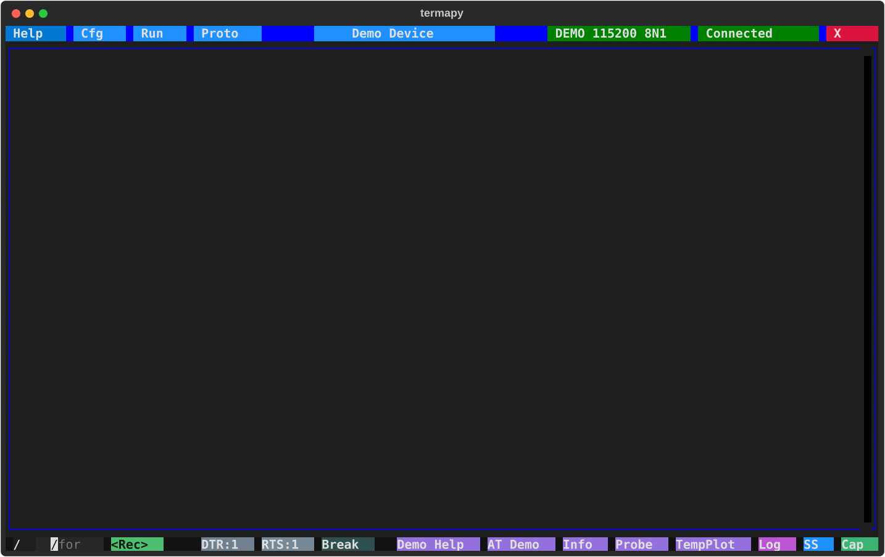

# Custom buttons

Add custom buttons to the toolbar by configuring `custom_buttons`
in your JSON config. Each button can send serial commands, run REPL commands,
or execute scripts. The default config includes one enabled button (**Info**, which runs
`/cfg.info`) plus three disabled placeholders.  Enable them and fill in
the fields, or add more entries.

Each button object has these fields:

| Field     | Description                                   |
| --------- | --------------------------------------------- |
| `enabled` | `true` to show the button, `false` to hide it |
| `name`    | Label displayed on the button                 |
| `command` | Command to execute when clicked               |
| `tooltip` | Hover text for the button                     |

## Example

```json
"custom_buttons": [
    {
        "enabled": true,
        "name": "Info",
        "command": "/cfg.info",
        "tooltip": "Project info"
    },
    {
        "enabled": true,
        "name": "Reset",
        "command": "ATZ",
        "tooltip": "Send ATZ reset"
    },
    {
        "enabled": false,
        "name": "Btn3",
        "command": "",
        "tooltip": "Custom button 3"
    }
]
```

## Command format

- Plain text is sent to the serial device (e.g. `"ATZ"`)
- Commands starting with `/` run as REPL commands (e.g. `"/run test.run"`)
- `{prefix}` at the start of a command stands for the config's `cmd_prefix`, so a button
  keeps working when the prefix is not `/`; the shipped Info button is `"{prefix}cfg.info"`
- Use `\n` to chain multiple commands (e.g. `"ATZ\nAT+INFO"`)
- Mixed serial and REPL commands work: `"ATZ\n/delay 500ms\nAT+INFO"`

## Placement

`custom_buttons_side` sets where the buttons go:

| Value              | Placement                                                 |
| ------------------ | --------------------------------------------------------- |
| `bottom` (default) | In the bottom bar, between the hardware buttons and Log   |
| `left`             | A column on the left edge of the output                   |
| `right`            | A column on the right edge of the output                  |

The bottom bar fits only a few buttons; a column stacks them with a blank
row above each and scrolls when there are more than fit. It is as wide as the longest name,
up to 24 columns. `/cfg custom_buttons_side right` moves the buttons for the
session; the config editor saves the setting.

In the bottom bar, a small gap separates the custom buttons from the hardware
buttons and the system buttons (Log, SS, Cap). The demo config's five buttons
(Demo Help through TempPlot):


