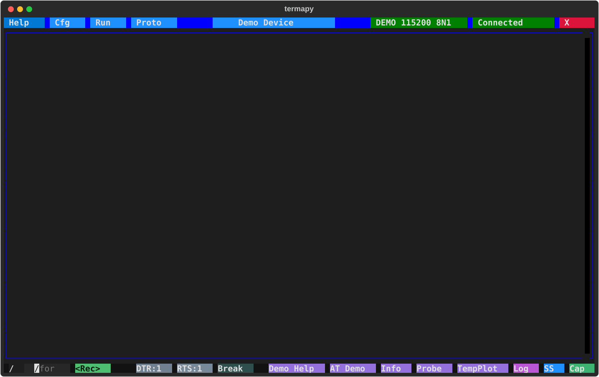

# Custom buttons

Add custom buttons to the toolbar by configuring `custom_buttons`
in your JSON config. Each button can send serial commands, run REPL commands,
or execute scripts. A new config has five: **Info**, which runs `/cfg.info`, turned
on, and one for each setting you change most, turned off until you enable it, each
showing its value: **Baud** (`/port.baud_rate cycle`), **EOL** (`/term.eol cycle`),
**Echo** (`/term.echo toggle`) and **Color** (`/term.color toggle`). A port opened by
name (`termapy COM3`, see [Quick open](getting-started.md#quick-open-just-a-port))
gets a config with EOL, Echo and Color turned on, in a column on the right of the
output. Edit them, enable them, or add more entries.

Each button object has these fields:

| Field     | Description                                   |
| --------- | --------------------------------------------- |
| `enabled` | `true` to show the button, `false` to hide it |
| `name`    | Label displayed on the button; see `{value}`  |
| `command` | Command to execute when clicked               |
| `tooltip` | Hover text for the button                     |

## Example

```json
"custom_buttons": [
    {
        "enabled": true,
        "name": "Info",
        "command": "/cfg.info",
        "tooltip": "Project info"
    },
    {
        "enabled": true,
        "name": "Reset",
        "command": "ATZ",
        "tooltip": "Send ATZ reset"
    },
    {
        "enabled": false,
        "name": "Btn3",
        "command": "",
        "tooltip": "Custom button 3"
    }
]
```

## Command format

- Plain text is sent to the serial device (e.g. `"ATZ"`)
- Commands starting with `/` run as REPL commands (e.g. `"/run test.run"`)
- `{prefix}` at the start of a command stands for the config's `cmd_prefix`, so a button
  keeps working when the prefix is not `/`; the shipped Info button is `"{prefix}cfg.info"`
- Use `\n` to chain multiple commands (e.g. `"ATZ\nAT+INFO"`)
- Mixed serial and REPL commands work: `"ATZ\n/delay 500ms\nAT+INFO"`
- A setting's `toggle` or `cycle` makes a one-click switch: `"/term.hex toggle"` flips
  hex display, and `"/term.output cycle"` steps through the output levels

## Showing a setting

`{value}` in a button's name shows the setting its command toggles or cycles:

```json
{
    "enabled": true,
    "name": "Stamps {value}",
    "command": "{prefix}term.timestamps toggle",
    "tooltip": "Timestamps on received lines"
}
```

The button reads `Stamps off`, and a click turns it into `Stamps on`. The value is what
the bare command answers (`/term.timestamps` answers `off`), read again after every
command, so a change typed or made by a script shows too. `{value}` needs a command
that toggles or cycles a setting; on any other, the config load warns and the button
shows `-`, which is also what it shows when the setting has nothing to give.

## Placement

`custom_buttons_side` sets where the buttons go:

| Value              | Placement                                                 |
| ------------------ | --------------------------------------------------------- |
| `bottom` (default) | In the bottom bar, between the hardware buttons and Log   |
| `left`             | A column on the left edge of the output                   |
| `right`            | A column on the right edge of the output                  |

The bottom bar fits only a few buttons; a column stacks them with a blank
row above each and scrolls when there are more than fit. It is as wide as the longest name,
up to 24 columns. `/cfg custom_buttons_side right` moves the buttons for the
session; the config editor saves the setting.

In the bottom bar, a small gap separates the custom buttons from the hardware
buttons and the system buttons (Log, SS, Cap). The demo config's five buttons
(Demo Help through TempPlot):


