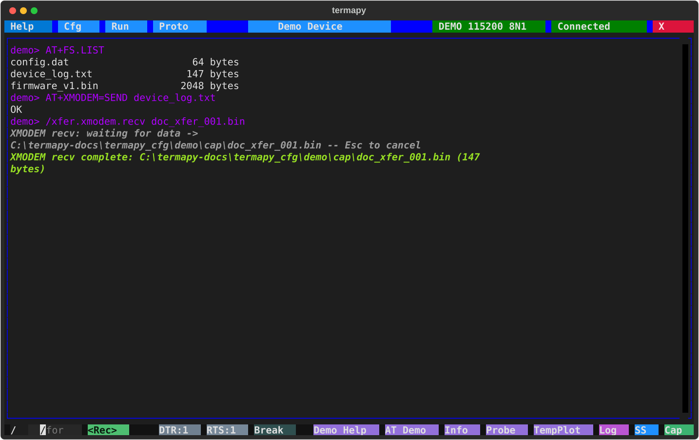

# File transfer

Transfer files to and from serial devices using the XMODEM, YMODEM or
ZMODEM protocols. XMODEM and YMODEM are widely supported by bootloaders,
firmware updaters, and embedded systems; ZMODEM is what a Linux console
speaks through `lrzsz` (`rz` and `sz`). Each block reaches the driver in
192-byte pieces (`tx_chunking`, on by default), the measured remedy for
bytes lost at high baud; see
[Serial ports](ports.md#large-sends-go-out-in-pieces).

## XMODEM

### Send a file

```text
/xfer.xmodem.send <file>
```

Send a file from your PC to the device. The file path is resolved
relative to the per-config `cap/` directory, or provide an absolute path.

```text
/xfer.xmodem.send firmware.bin
/xfer.xmodem.send C:\builds\release.hex
```

The device must be waiting to receive via XMODEM before you run this
command (e.g. after entering a bootloader's receive mode).

### Receive a file

```text
/xfer.xmodem.recv <file>
```

Receive a file from the device and save it to the `cap/` directory.
Supports auto-numbered filenames with `$(n000)`. The data arrives as
`<file>.part` and replaces `<file>` only when the transfer completes, so a
canceled or failed receive leaves a file already at that name as it was.

```text
/xfer.xmodem.recv dump.bin
/xfer.xmodem.recv log_$(n000).bin
```

### Protocol details

- Automatic CRC/checksum negotiation
- 128-byte blocks
- Progress reported during transfer

A MicroPython [dev board](boards.md) running termapy's firmware is an XMODEM
peer: `xmodem recv` / `xmodem send` on the board pairs with `/xfer.xmodem.*`
here, the same way the demo device does, but over a real serial link.

## YMODEM

YMODEM extends XMODEM with batch file transfer, 1024-byte blocks,
and automatic filename/size metadata in the protocol header.

### Send file(s)

```text
/xfer.ymodem.send <file> {file2} ...
```

Send one or more files. YMODEM includes the filename and size in the
protocol, so the receiver knows what to expect.

```text
/xfer.ymodem.send firmware.bin
/xfer.ymodem.send config.json data.bin     batch send
```

### Receive file(s)

```text
/xfer.ymodem.recv {directory}
```

Receive files from the device. YMODEM provides the filename
automatically. Files are saved to the specified directory, or `cap/`
by default. They arrive in a `.part-*` staging folder and move into place
only when the transfer completes, under the base name the sender gave (a
`../` in the name is dropped), so a canceled or failed receive leaves the
folder as it was.

```text
/xfer.ymodem.recv                          save to cap/
/xfer.ymodem.recv C:\downloads             save to specific directory
```

### YMODEM protocol details

- 1024-byte blocks (1K) with CRC-16
- Filename and filesize sent in protocol header
- Batch transfer: send/receive multiple files in one session

## ZMODEM

**Status: preview.** ZMODEM is the protocol of a Linux serial console:
`lrzsz` ships `rz` (receive) and `sz` (send) on OpenWrt, Buildroot and
Yocto images and on any distribution. Start the device side first; termapy
waits 10 seconds for the first frame.

### Send to rz

```text
/xfer.zmodem.send <file> {file2} ...
```

Type `rz` on the device, then send one or more files. ZMODEM carries each
file's name and size, so the device needs no name.

```text
/xfer.zmodem.send firmware.bin
/xfer.zmodem.send config.json data.bin     batch send
```

### Receive from sz

```text
/xfer.zmodem.recv {directory}
```

Type `sz <file>` (or `sz a b c`) on the device, then receive. Files are
saved to the specified directory, or `cap/` by default, under the names
the device sent; as with YMODEM they arrive in a `.part-*` staging folder
and move into place only when the transfer completes.

```text
/xfer.zmodem.recv                          save to cap/
/xfer.zmodem.recv C:\downloads             save to specific directory
```

### ZMODEM protocol details

- Data streams in 1024-byte subpackets with CRC-32 and no per-block
  acknowledgment, so a transfer runs at the speed of the link
- Filename and filesize sent in the protocol
- Batch transfer: send/receive multiple files in one session
- **Esc** sends the ZMODEM cancel sequence, so `rz` or `sz` on the device
  returns to its prompt

The limits of the preview, stated so nothing surprises you:

- A receive starts from zero; an interrupted transfer is not resumed
- A corrupted byte ends the transfer with a CRC error, reported in the
  reply, instead of being retransmitted: use it over a clean link such as
  a USB-serial adapter, and XMODEM or YMODEM over a noisy one
- The receiver on the device must do full-duplex streaming with CRC-32,
  which `lrzsz` and every modern `rz` do

## File paths

By default, file paths are resolved relative to the per-config `cap/`
directory. Absolute paths are always accepted.

```text
/xfer.xmodem.send firmware.bin              cap/firmware.bin
/xfer.xmodem.send C:\builds\release.hex     absolute path
/xfer.xmodem.recv dump.bin                  saved to cap/dump.bin
/xfer.xmodem.recv log_$(n000).bin           auto-numbered in cap/
/xfer.ymodem.send config.json               cap/config.json
/xfer.ymodem.recv                           saved to cap/ (filename from protocol)
/xfer.ymodem.recv C:\downloads              saved to specified directory
/xfer.zmodem.send firmware.bin              cap/firmware.bin
/xfer.zmodem.recv                           saved to cap/ (filename from protocol)
```

### Custom transfer root

```text
/xfer.root                             show current root
/xfer.root C:\builds\firmware          set a custom root
```

When set, both send and receive resolve relative paths against this
directory instead of `cap/`. The transfer root is shown as a clickable
path when a config loads (at the verbose output level).

This sets the `file_xfer_root` config key, which can also be edited
directly in the JSON config file.

The `cap/` directory lives inside the active config folder. For example,
if your config is `termapy_cfg/mydevice/mydevice.cfg`, then `cap/` is
`termapy_cfg/mydevice/cap/`. In demo mode, it's `termapy_cfg/demo/cap/`.

Click the **Cap** button in the toolbar to open the `cap/` folder.

## Common details

- Transfers need a connected port and an interactive session (TUI or CLI); they are not available over MCP
- Serial display is suppressed during transfer and resumes afterward
- Press **Esc** to cancel an active transfer
- Progress reported during transfer

## XMODEM vs. YMODEM vs. ZMODEM

| Feature              | XMODEM             | YMODEM              | ZMODEM                     |
|----------------------|--------------------|---------------------|----------------------------|
| Block size           | 128 bytes          | 1024 bytes          | 1024-byte subpackets       |
| Error detection      | CRC-16 or checksum | CRC-16 always       | CRC-32, no retransmission  |
| Filename in protocol | No                 | Yes                 | Yes                        |
| Batch transfer       | No                 | Yes                 | Yes                        |
| Flow                 | Block, ACK, block  | Block, ACK, block   | Streaming, no per-block ACK |
| Use when             | Simple bootloaders | Larger files, batch | `rz` / `sz` on a Linux box |

## Demo mode

The demo device has a virtual filesystem pre-loaded with sample files and
speaks all three protocols: XMODEM, YMODEM and ZMODEM (its ZMODEM peer is
the same engine a real device runs). All examples below work in demo mode
(`termapy --demo`).

### Filesystem commands

```text
AT+FS.LIST                  list files with sizes
AT+FS.INFO                  file count and total size
AT+FS.DELETE <file>         delete a file
```

### Transfer commands

```text
AT+XMODEM=SEND <file>      send a file from device via XMODEM
AT+XMODEM=RECV <file>      receive into device VFS via XMODEM
AT+YMODEM=SEND <file>      send a file from device via YMODEM
AT+YMODEM=RECV              receive into device VFS (name from protocol)
AT+ZMODEM=SEND <file>...   send file(s) from device via ZMODEM
AT+ZMODEM=RECV              receive file(s) into device VFS via ZMODEM
```

Pre-loaded files: `config.dat` (64 bytes), `device_log.txt` (147 bytes),
`firmware_v1.bin` (2048 bytes).

### Example: pull a file via ZMODEM

The device runs the ZMODEM sender; termapy receives into `cap/`:

```text
AT+ZMODEM=SEND firmware_v1.bin     device enters ZMODEM send mode
/xfer.zmodem.recv                       termapy receives (name from protocol)
```

To push a file back, `AT+ZMODEM=RECV` then `/xfer.zmodem.send <file>`.

### Example: pull a file via XMODEM

Tell the device to send first, then termapy receives.
Both commands are needed -- one for each end of the transfer:

```text
AT+XMODEM=SEND device_log.txt      device enters XMODEM send mode
/xfer.xmodem.recv device_log.txt        termapy receives into cap/
```



### Example: push a file back via XMODEM

After pulling a file (above), you can push it back under a new name.
Again, tell the device first:

```text
AT+XMODEM=RECV log_backup.dat      device enters XMODEM receive mode
/xfer.xmodem.send device_log.txt        termapy sends from cap/
AT+FS.LIST                         verify it arrived on device
```

### Example: pull a file via YMODEM

YMODEM includes the filename in the protocol, so the receiver
gets the name automatically:

```text
AT+YMODEM=SEND firmware_v1.bin     device enters YMODEM send mode
/xfer.ymodem.recv                       termapy receives (name from protocol)
```

### Example: push a file back via YMODEM

After pulling firmware (above), push it back:

```text
AT+YMODEM=RECV                     device enters YMODEM receive mode
/xfer.ymodem.send firmware_v1.bin       termapy sends from cap/
AT+FS.LIST                         verify it arrived on device
```

### Example: browse, transfer, and clean up

```text
AT+FS.LIST                         see what's on the device
AT+FS.INFO                         file count and total size
AT+XMODEM=SEND device_log.txt      pull the log
/xfer.xmodem.recv device_log.txt
AT+FS.DELETE device_log.txt         clean up on device
AT+FS.LIST                         confirm deletion
```

See [Data Capture](data-capture.md) for passive serial capture to files.
