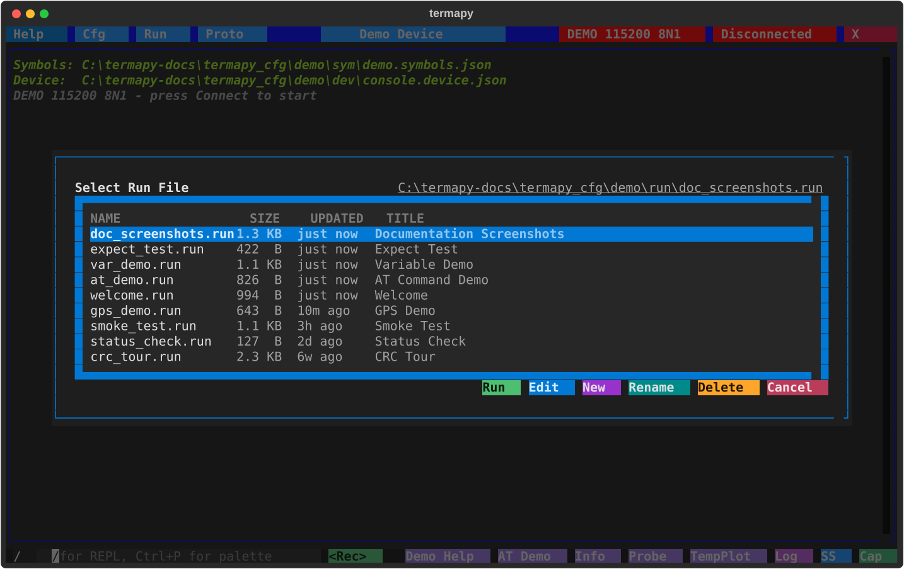
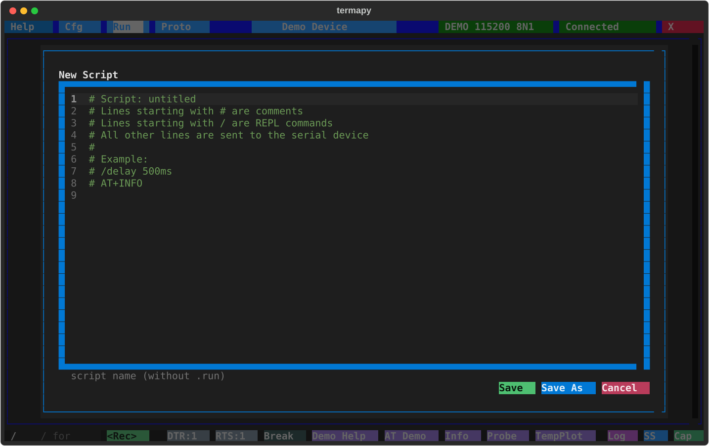

# Scripting

Click the **Run** button in the title bar or use `/run <filename>` to work
with scripts (bare `/run` in the CLI lists them).  The picker lists
scripts newest first with size, last-updated age, and each script's
docstring summary, and has six actions:

- **Run:** execute the highlighted script
- **Edit:** open the highlighted script in the editor
- **New:** create a new script (opens the editor with a template)
- **Rename:** rename the highlighted script (`.run` is kept; never overwrites)
- **Delete:** delete the highlighted script, after a yes: it runs `/run.delete <name>`
- **Cancel:** close the picker



The script editor provides syntax highlighting (bash-style) for comments
and a name field. Scripts are saved with a `.run` extension in the per-config
`run/` folder.



## Script file format

- Serial commands (sent to the device)
- `/` prefixed REPL commands (delays, screenshots, print, etc.)
- Comments (lines starting with `#`)
- Blank lines (ignored)
- Sequence counters with `{seqN+}` for auto-incrementing values

A leading `#` comment block (lines 1..N, ending at the first blank or
non-comment line) is the script's docstring: the first line is the
summary shown by `/run.list`; the full block is what `/run.help <script>`
prints.

## Watching a run: `/run --echo`

A script runs quiet: its command lines are not echoed, only their output,
so a script does not flood the prompt with its own text. To follow along,
add `--echo` and each line prints as it runs, as if typed:

```text
/run --echo smoke_test
demo> /print one
  one
demo> /mem.dump gTemp 16
  1B 00 ...
```

`--echo` turns command echo on for that run only, regardless of the
session's `echo_repl` setting, and restores it when the script ends. It
pairs with `/run.verbose`, which adds a per-line `[step/total] (time)`
progress line, and with the output level, so `/run.verbose --echo` shows
the command, its full verbose output, and the timing. Useful when a script
misbehaves and you need to see which line did what.

## Recording a session

The fastest way to make a `.run` script is to record what you typed.

- **TUI:** click the **Record** button next to the REPL prompt, enter
  a filename, run the commands, click **Stop**.  Hide the button with
  `record_enabled: false` in your config.
- **CLI / MCP:** `/run.record <filename>` starts, bare `/run.record`
  stops.  Same lifecycle, no button.

Only successful dispatches land in the file -- failed commands,
typos, and `/run.record` itself are skipped.  The target file is
refused if it already exists (delete or pick a new name).  Add a `#`
docstring at the top of the recorded file and it becomes self-describing
in `/run.list` and `/run.help`.

## Replaying what you typed: `/run.last`

To run the last few commands again without retyping them or writing a
script, list them with bare `/run.last`:

```text
demo> /run.last
  typed in demo - 4 lines
  #  COMMAND     RESULT
  -  ----------  -----------------------
  3  /port.info  ok
  2  AT+VER      ok
     /nosuch     Unknown command: nosuch
  1  AT+STATUS   ok
```

`/run.last 2` runs lines 2 and 1 again, in the order you typed them. Each
command is echoed as it runs, as `/run --echo` does; a device line echoes
as your `echo` setting says, as it did when you typed it. Escape stops the
replay, and so does the first line that fails. In the TUI, clicking a
number puts `/run.last N` in the prompt for you to run.

The list is what you typed, line for line. A typed `/run my_script` is one
line: replaying it runs the script again, and the script runs its own
steps. The lines inside a script are never listed, nor a paste, nor
`/run.last` itself.

`/run.last` is a convenience for the prompt, not a script command: a
script that runs it is refused (`Not available in a script.`), and so is
a replay inside a replay.

Only a line that succeeded gets a number. A failed one is listed with its
error and never replays: fix it from the Up-arrow history instead. Each
config keeps its own list while termapy runs; a restart starts every list
empty.

## Script commands

| Command | Description |
|---------|-------------|
| `/delay <duration>` | Pause execution (e.g. `500ms`, `2s`, `1.5s`). Escape or Ctrl+C cancels it and the script. |
| `/expect {timeout=<dur>} match=<text>` | Wait for a serial line containing `<text>` (default 5s). A timeout fails the line and stops the script. |
| `/expect.regex {timeout=<dur>} match=<pattern>` | Same but the pattern is a regex. |
| `/confirm {message}` | Ask Yes/Cancel: a dialog in the TUI, a y/n prompt in the CLI. Canceling stops the script. |
| `/run <script>` | Run a nested script (max 5 levels deep) |
| `/run.profile <script>` | Run nested script with per-line timing |
| `/run.rename <old> <new>` | Rename a script (`.run` is kept; never overwrites) |

Keywords use `key=value` syntax (spaces around `=` are OK). `match=` must be
last -- everything after it is the pattern.

`/expect` also searches lines that arrived before it ran, so a fast reply is
not missed. A match consumes the output up to and including the matched line:
two `AT` / `/expect match=OK` pairs in a row each wait for their own `OK`.

## Profiling

Run a script with per-line timing to find slow spots:

```text
/run.profile smoke_test
```

This saves a CSV to the `prof/` folder with elapsed time for each line.

| Command                      | Description                              |
| ---------------------------- | ---------------------------------------- |
| `/run.profile <script>`      | Run script with per-line timing          |
| `/run.profile.cmd <command>` | Profile a single command                 |

The CSVs are listed, printed and opened with the per-folder file commands
(`/run.profile.list`, `.dump`, `.show`); see the command reference.

## Output levels

A single dial controls how loud commands are. Four monotonic levels:

| Level     | Result | Output | Status | Use                                       |
| --------- | :----: | :----: | :----: | ----------------------------------------- |
| `silent`  |   —    |   —    |   —    | scripts reading only `CmdResult.value`    |
| `quiet`   |   ✓    |   —    |   —    | show the answer, drop the rest            |
| `normal`  |   ✓    |   ✓    |   —    | default                                   |
| `verbose` |   ✓    |   ✓    |   ✓    | show progress chatter and timing          |

Set the session default with `/term.output <level>`. Override for a single
call with `cmd --<level>` or `cmd.<level>`:

```text
/term.output quiet              # session default
/cfg baud_rate                  # shows 115200
/help port --verbose            # one call back to verbose
/cap.dump capture.bin --silent  # run, drop output, only value returns
```

Set the level at startup with `--silent`, `--quiet`, or `--verbose` on the
`termapy` command line.

## JSON output: `/term.request on`, or `--json` per call

`/term.request on` is the session's structured dial: **everything** answers
in JSON -- bare device commands as request/response envelopes, termapy
commands as result envelopes.  The device/termapy demarcation is deliberately
invisible; the session is either in JSON mode or in prose mode.

For a single call in a prose-mode session, every command also accepts
`--json`, which renders that one result as an envelope:

```text
/port.list --json
{"cmd": "/port.list", "success": true, "error": "", "value": "COM3,COM4",
 "data": [{"device": "COM3", ...}], "output_lines": [], "elapsed_s": 0.02}
```

`data` carries the structured form, with no rows of text beside it:

- **Every list** (`/port.list`, `/port.chip.list`, `/proto.crc.list`, the
  folder listings `/run.list` / `/cap.list` / `/ss.list` / `/proto.list` /
  `/plugin.list` as `{name, bytes, mtime, age_s}` records, `mtime` ISO-8601
  and `age_s` seconds, ...) is a list of records -- except where each item
  is one value under a unique name: `/env.list` is `{NAME: value}` and
  `/port.chip.<field> *` is `{device: value}`, so you look a name up.
- **Every status page** (`/mcp.info` with the server's `pid`, `/term.info`,
  `/port.info`, `/mem.info`, `/sym.info`, `/profile.info`, `/seq`, ...) is
  one record of real values; `/port.chip *` is a list of them.
- `/var`, `/port.usb` and profile-mapped device commands have their own shapes.

For everything else it
is `null` and the command's rendered answer arrives in `output_lines` (markup
flattened to plain text) -- `/help --json` is one envelope containing the
help text, nothing printed outside it.  Errors arrive in the `error` field
rather than as a separate red line.  Composes with the level flags -- the
envelope rides the result channel, so `--json --quiet` prints just the
envelope and `--json --silent` prints nothing (scripts still read `value`).
From a shell, `termapy --cli -e "/port.list --json"` pipes cleanly to `jq`.

On a bare device line, `--json` is the one-call form of the request/response
dial: `MEM.R 0x1000 2 --json` sends the line, waits for the reply, and returns
it in `value` -- exactly what `/term.request on` does for every line.  Without
the flag a bare line is a plain send, and the reply arrives in the scrollback.

For plugin authors: `ctx.result()` is the answer, `ctx.output()` is bulk
data, `ctx.status()` is progress chatter. Each gates on the active level.
Handlers that produce scriptable data must call `CmdResult.ok(value=...)`
so silent mode is useful.

> **Migrating older scripts.** Scripts that used `/verbose on/off`,
> `/term.verbose on/off`, or `*.quiet` as a "set silently" idiom keep
> working via hidden forwarders. Run `/run.legacy <file>` to preview
> the canonical replacements, or `/run.legacy --fix <file>` to rewrite
> in place. A [name pattern](commands.md#name-patterns) processes every
> script it matches: `/run.legacy *` is all of `run/`.

## Example script

```text
# smoke_test.run -- quick device check
AT
/expect match=OK
AT+INFO
/expect timeout=2s match=Bassomatic
AT+TEMP
/expect.regex timeout=2s match=\d+\.\d+C
AT+STATUS
/ss.svg smoke_{seq1+}
```
