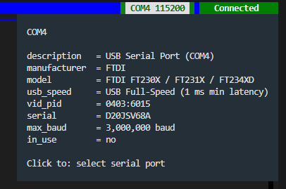
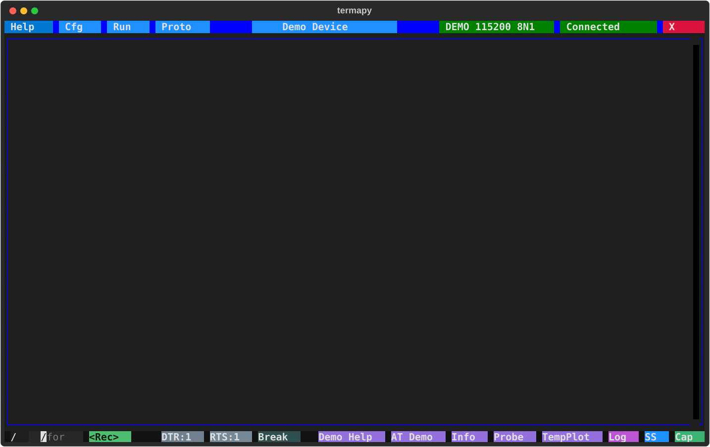
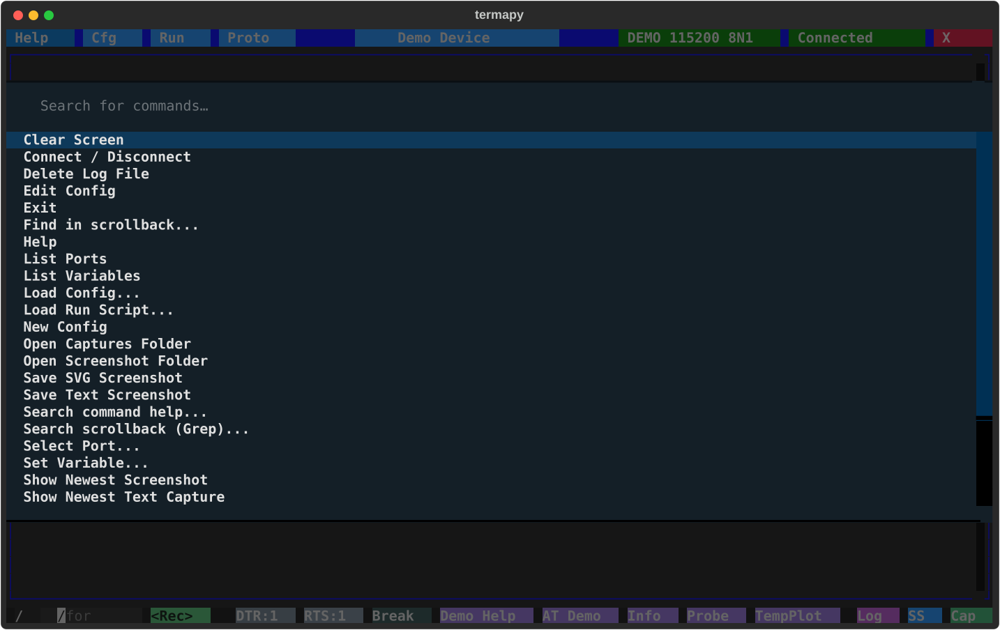

# Toolbar and shortcuts

## Title bar buttons

The top bar has the title-bar buttons plus a centered config name:

| Button          | Position    | Action                                          |
| --------------- | ----------- | ----------------------------------------------- |
| **Help**        | Top-left    | Open this help guide                            |
| **Cfg**         | Top-left    | Load / Edit / Explorer (Finder, Files) / New / Rename / Delete a config |
| **Run**         | Top-left    | Run / Edit / New / Rename / Delete a script     |
| **Proto**       | Top-left    | Run / Debug / Edit / New / Rename / Delete a .pro script |
| **Update**      | Top-left    | Appears only when a newer termapy is on PyPI    |
| **Config name** | Center      | Click to edit the currently-loaded config       |
| **Port name**   | Top-right   | Click to open the serial port picker            |
| **Status**      | Far-right   | Click to connect or disconnect                  |
| **X**           | Corner (OS) | Red — close the connection and quit             |

The **X** sits top-left on macOS/Linux and top-right on Windows, matching
each platform's window-control convention.  Cfg, Run, and Proto can be
hidden per config via `cfg_enabled`, `run_enabled`, and `proto_enabled`.
Typing the bare command (`/cfg`, `/run`, `/proto`, or `/port` for the
port name) is equivalent to clicking the button; in the CLI, which has
no pickers, it runs the matching `.list` instead.  The Cfg, Run, and
Proto pickers list files newest first with size and age columns under a
header row; Run adds the script's docstring summary, Cfg the port,
baud, and title.

Hover over any of the config, port, or status buttons to see a detailed
tooltip with current settings and chip information.

### Port picker

Clicking the port name in the title bar (or picking **Select Port**
from the command palette) opens a dialog listing every connected
serial port with its USB chip identification.  The list auto-refreshes
about once a second, so plug / unplug events appear without re-opening
the dialog — handy for identifying which COM port belongs to which
physical device.  For a full tour of the port picker, the `/port.info`
and `/port.chip` commands, the `termapy --info` CLI flag, and the rest
of termapy's serial-port diagnostics, see [Serial ports](ports.md).

## Toolbar buttons

The bottom bar has buttons. Some appear based on context:

| Button      | When Visible                 | Action                                          |
| ----------- | ---------------------------- | ----------------------------------------------- |
| **/**       | Always                       | Show REPL command picker (filters as you type)  |
| **\<Rec\>** | `record_enabled` (default)   | Record typed commands to a .run script          |
| **DTR:0/1** | `flow_control` is `"manual"` | Toggle the DTR hardware line                    |
| **RTS:0/1** | `flow_control` is `"manual"` | Toggle the RTS hardware line                    |
| **Break**   | `flow_control` is `"manual"` | Send a 250ms serial break signal                |
| **Custom**  | `custom_buttons` enabled     | User-defined command buttons                    |
| **Log**     | Always                       | Open the session log in your editor             |
| **SS**      | Always                       | Open the screenshot folder                      |
| **Cap**     | Always                       | Open the cap/ folder                            |
| **^ v x**   | While `/find` is active      | Previous / next match, close the find bar       |

Bare `/log`, `/ss` and `/cap` do what the Log, SS and Cap buttons do.
`/help <cmd>` states a command's bare form in its SYNOPSIS.

Scripts are picked and run from the **Run** button in the title bar
(or `/run`); quitting is the red **X** in the title bar (or Ctrl+Q).

## Keyboard shortcuts

| Key                    | Action                                              |
| ---------------------- | --------------------------------------------------- |
| **Ctrl+Q**             | Quit (also dismisses any open dialog)               |
| **Escape**             | Stop, close; clear prompt; empty: Esc to the device |
| **F1**–**F4**          | Help / Cfg / Run / Proto (same as the buttons)      |
| **F10**                | Edit the current config                             |
| **Ctrl+Shift+1**–**5** | Same four, plus Edit Config on **5**                |
| **Ctrl+P** / **Alt+P** | Open command palette                                |
| **Ctrl+S** / **Alt+S** | Save SVG screenshot                                 |
| **Ctrl+T** / **Alt+T** | Save text screenshot                                |
| **Ctrl+C** / **Cmd+C** | Copy the selection; with none, Ctrl-C to the device |
| **Ctrl+D**             | On an empty prompt, send Ctrl-D to the device       |
| **Ctrl+Z**             | On an empty prompt, send Ctrl-Z to the device       |
| **Ctrl+V** / **Cmd+V** | Paste into the prompt; several lines are all sent   |
| **Ctrl+A**             | Select all output text (click the output first)     |
| **Shift+Up**           | Select output from the newest line, from the prompt |
| **Shift+arrows**       | Grow or shrink an output selection                  |
| **Up/Down**            | Cycle through command history                       |
| **Right**              | Accept type-ahead suggestion                        |

The `Ctrl+Shift+digit` and `Alt+letter` aliases work inside VS Code's
integrated terminal, which intercepts some F-keys and Ctrl chords.
Clearing the screen is `/cls` (or the palette's Clear Screen); the
screenshot folder is the **SS** button (or `/ss.explore`).

## Pasting several lines

Paste a block of lines into the prompt and every line is sent, one after
another, as if you typed it and pressed Enter, as TeraTerm does: a device
line goes as pasted, indentation and all, a blank line sends a bare line
ending, and a line starting with `/` runs as a command, so a pasted script
works too.  The lines go `multiline_paste_delay_ms` apart (10 by default,
TeraTerm's), giving a device time to take each one.  **Escape** stops the
rest, and a line that fails stops it as well.  A one-line paste lands in
the prompt for you to edit.  Set `multiline_paste` to `false` to paste
only the first line, as before.

## Copying text

Drag across the main output window to select text, then press
**Ctrl+C** (**Cmd+C** on macOS) to copy it to your clipboard.  With
nothing selected, **Ctrl+C** belongs to the device, as in any terminal:
termapy sends it Ctrl-C (byte 03), the key that stops a running
MicroPython program.  On an empty prompt **Ctrl+D** sends Ctrl-D and
**Ctrl+Z** sends Ctrl-Z, the key an AT modem takes to send an SMS.
**Escape** with nothing running clears the prompt, or sends Esc when it
is empty. `/term.control_keys off` keeps these keys termapy's for the
session; `"control_keys": false` in the config file keeps them so.
`/term.ctrl` sends any control character from a script or the CLI.  The
selection is highlighted, and the copy is the text as shown: wrapped
lines and table rules included, colors dropped.  Click the window
first and press **Ctrl+A** to select everything.  The
copy travels over the terminal's OSC 52 channel, so it lands on the
clipboard of whatever machine your terminal is running on — including
over SSH.  Terminals cap how much one copy may carry, and cut a
larger one short without saying so; the session log holds the whole
session.  A few older terminals don't support OSC 52; if the copy
does nothing, hold **Shift** (or **Alt** in some terminals) while
dragging to use your terminal's own selection instead.

The keyboard selects too.  From the prompt, **Shift+Up** selects the
newest output line, and each further press grows the selection a line
up.  In the output window, **Shift** with an arrow key moves the
selection's end a character or a line, **Shift+Home** and
**Shift+End** move it to the start or end of the line, and
**Shift+PageUp** and **Shift+PageDown** move it a page; it starts
from where you last clicked, or extends a selection you dragged.
While anything is selected the window stops following new output, so
the selection stays put, and catches up when it ends.  **Escape**
clears the selection and returns you to the prompt, and typing any
character does the same, typing it there.

## Command palette

Press **Ctrl+P** (or **Alt+P** if your terminal captures Ctrl+P --
VS Code's integrated terminal does) to open the command palette.
It drops down from the top-center of the window, like VS Code's
command palette, with fuzzy filtering as you type and a most-recently-used
list when opened with an empty query.

Highlights include:

- Help
- Find in scrollback / Grep scrollback / Search command help
- Select Port
- Connect / Disconnect
- Edit, Load, or Create a Config
- Load Run Script
- View / Delete Log File
- Clear Screen
- Save SVG / Text Screenshot
- Open Screenshot Folder
- Open Captures Folder
- Show Newest Screenshot
- Show Newest Text Capture
- Exit
